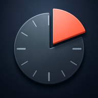

# ClockMods Web

**打开浏览器，给屏幕一个新的日常用途。**

十二套时钟主题 · 六个工具页面 · 世界时钟 · 可安装 PWA · 无广告

ClockMods Web 把时钟、日历和常用计时工具放进浏览器。电脑、手机和平板都能使用，选好主题与背景，就能拥有一块适合桌面、学习或工作的时间屏幕。

## 十二套主题，横放竖放都好看

| 主题 | 视觉特点 |
| --- | --- |
| 经典 | 清晰的大字时间与传统全屏布局 |
| 玻璃工坊 | 金属玻璃表盘与独立信息区 |
| 黑金仪表 | 黑金刻度表盘与秒数仪表 |
| 纸感时站 | 纸张横线、红色边线与模拟表盘 |
| 霓虹轨道 | 时、分、秒三层进度环 |
| 数字网格 | 技术网格与七段数字面板 |
| 字形时刻 | 深浅分区、大字排版与秒数进度条 |
| 双块 | 小时、分钟独立大面板与花瓣秒数徽章 |
| 轨道 | 三层同心轨道、动态秒点与中心时间 |
| 气泡 | 小时矩形、分钟花瓣圆与秒数圆 |
| 混合 | 左右或上下排列的模拟表盘与数字面板 |
| 丝带 | 倾斜底板、胶囊时间条与花瓣秒数徽章 |

各套主题分别保存字体、配色与显示设置。调整颜色、背景和字号时，设置页会实时预览效果，还可切换横竖屏预览；点击“应用”才保存，取消即可保留原来的样子。

## 让时间，融入你喜欢的画面

用本机照片作为背景，调整字体、字重与文字大小，再选择适合的数字和天气切换动效。部分卡片主题支持卡片内背景模糊，模糊与亮度可以分别调节。

支持的浏览器还可在授权后读取本机字体，挑选字重、斜体或窄体款式。字体只在本机读取，不上传；未支持这一能力的浏览器仍可使用内置字体。

想了解远方的时间，可以添加并排序最多六个世界时钟城市。整点与半点视觉报时配有多种动画，也能设置安静时段。

## 六个页面，照顾不同的时间需求

| 工具 | 用来做什么 |
| --- | --- |
| 时钟 | 全屏查看时间、日期、天气与自定义留言 |
| 月历 | 浏览月份、点选日期，查看农历、节气、节日与传统宜忌 |
| 番茄钟 | 在工作、短休息和长休息之间切换 |
| 闹钟 | 设置提醒时间和重复规则 |
| 倒计时 | 选择快捷时长或自行设定，到点提醒 |
| 秒表 | 连续计时与记录分段成绩 |

月历提供石墨、纯黑、纸历、海报、周程五种布局。历法信息在本地计算，休 / 班标记覆盖已收录年份；周程用于浏览日期，不提供日程编辑。

## 像应用一样打开，也能离线看时间

支持安装的浏览器可以将 ClockMods Web 添加到桌面。首次加载并完成缓存后，时钟、离线日历等基础页面无需持续联网；天气仍需连接服务。

常亮、全屏、方向锁定与安装能力取决于浏览器和设备。使用闹钟、倒计时或报时时，请保持页面运行；后台休眠或关闭页面可能延迟、停止提醒。

## 开始体验

1. 在现代浏览器中打开已部署的站点；自行部署可参考 [部署与配置说明](docs/product-development-guide.md)。
2. 双击时钟或点击设置按钮，挑选主题、背景与字体，点击“应用”。
3. 用导航切换工具页，按需要开启天气或添加世界时钟城市。
4. 浏览器提供安装入口时，可将站点添加到桌面，方便下次打开。

本仓库提供可自行部署的网页源码，见 [获取 Web 版本](https://github.com/heyiWF/ClockMods/tree/web)。安装和离线缓存等能力通常需要 HTTPS 或本机访问环境；IE 11 设备可选择 [Web Legacy](https://github.com/heyiWF/ClockMods/tree/web-legacy)。

## 设置留在本机，天气按需连接

无需账号，不含广告或用户行为统计。设置、背景图片和选用的直连凭据保存在当前浏览器，没有内置云同步；清除站点数据会移除这些内容。

天气可使用自行配置的服务凭据或代理，自动定位需要位置权限，也可以手动选城市。具体接入方式见 [天气与校时配置](docs/product-development-guide.md#天气与校时配置)。

## 更多

- [反馈问题与建议](https://github.com/heyiWF/ClockMods/issues)
- [开发与配置参考](docs/product-development-guide.md)
- 其他版本：[Android 经典系列](https://github.com/heyiWF/ClockMods/tree/main) · [Ultimate](https://github.com/heyiWF/ClockMods/tree/ultimate) · [Ultimate Compose](https://github.com/heyiWF/ClockMods/tree/ultimate-compose) · [Web](https://github.com/heyiWF/ClockMods/tree/web) · [Web Legacy](https://github.com/heyiWF/ClockMods/tree/web-legacy)

## 许可与致谢

ClockMods 项目采用 [MIT 许可证](https://github.com/heyiWF/ClockMods/blob/main/LICENSE)，第三方资源遵循各自许可：

- 天气：[QWeather](https://www.qweather.com)；图标：[QWeather Icons](https://icons.qweather.com)（CC BY 4.0）。
- 农历：[tyme4ts](https://github.com/6tail/tyme4ts)（MIT）；节假日：[holiday-cn](https://github.com/NateScarlet/holiday-cn)（MIT）。
- 字体与其他资源的许可见 `src/assets/fonts/` 与 `public/licenses/`；系统字体按设备可用字体回退。

- 设置侧栏图标：[Google Material Icons](https://developers.google.com/fonts/docs/material_icons)（Apache 2.0）。城市译名：[Unicode CLDR](https://cldr.unicode.org/)；简繁字符映射：[OpenCC](https://github.com/BYVoid/OpenCC)。许可见 `public/licenses/`。
